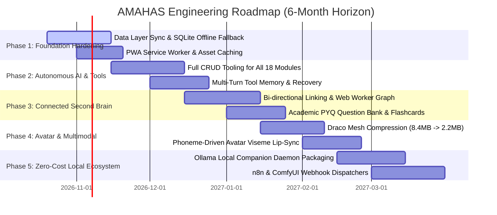

# AMAHAS Student OS — Architecture Improvement Roadmap

**Roadmap Horizon:** 6 Months (Phases 1 through 5)  
**Budget Constraint:** **Strictly ₹0 Infrastructure Spend** (Utilizing local hardware, Edge serverless, and free-tier open models)  
**Target Maturity:** From Functional Beta to Enterprise-Grade Personal AI Operating System  
**Audience:** Kishore, Lead Architects, and Systems Engineers  

---

## 1. Architectural Strategy & Phased Horizons

The next phase of AMAHAS engineering focuses on elevating the platform from a feature-rich prototype to an unshakeable, offline-first personal operating system. The roadmap is structured into 5 cohesive phases, each with clear deliverables, measurable acceptance criteria, and zero budget footprint.

---

## 2. Phase-by-Phase Implementation Specifications

### Phase 1: Core System & Data Layer Hardening (Weeks 1–4)
**Objective:** Guarantee data durability, offline resilience, and eliminate dual-state discrepancies between PostgreSQL and browser LocalStorage.

- **Deliverables:**
  1. **Offline-First Synchronizer (RxDB / IndexedDB Bridge):**
     - Allow full offline task creation, note writing, and flashcard practice without an active network connection.
     - When internet connection is restored, background sync automatically flushes queued mutations to Prisma/PostgreSQL using optimistic UI updates.
  2. **Bi-Directional Preference Synchronization:**
     - Move theme selection, audio volume levels, and avatar preferences directly into `UserPreference` relational table, keeping `localStorage` strictly as a fast read-through cache.
  3. **Progressive Web App (PWA) Offline Manifest:**
     - Register service worker for caching static JS/CSS bundles, fonts, and Web Audio synthesizers for instant offline startup.
- **Acceptance Criteria:**
  - Application boots and allows task creation and SM-2 flashcard practice with network disconnected in DevTools.
  - Reconnecting network triggers automated two-way conflict-free sync within 3 seconds.

---

### Phase 2: Autonomous AI Assistant & Full Application Tooling (Weeks 5–8)
**Objective:** Expand assistant tool capabilities from current core tools to full CRUD coverage across all 18 modules.

- **Deliverables:**
  1. **Omni-Module Tool Registry Expansion:**
     - Implement tool schemas and handlers for:
       - `create_note`, `search_notes`, `append_note_backlink`
       - `create_habit`, `log_habit_completion`
       - `create_goal`, `update_milestone_progress`
       - `create_reminder`, `snooze_reminder`
       - `add_research_paper_to_project`
  2. **Multi-Turn Action Plan Execution:**
     - Allow the assistant to decompose complex user prompts (e.g. *"Set up my study schedule for GATE Analog Circuits next week with daily 45m blocks and add a reminder for Sunday"* ) into a sequenced multi-step action plan displayed in a review drawer.
  3. **Proactive Study Suggestions:**
     - Autonomous background evaluator that identifies topics with declining SM-2 retention and prompts the student during morning briefings: *"Fourier Transform confidence has dropped below 60%. Schedule a 20-minute review today?"*
- **Acceptance Criteria:**
  - Assistant successfully executes multi-step plans touching Tasks, Planner, Reminders, and Academics in a single conversation turn.
  - Regression test suite expanded from 68 to 90+ tests with 100% pass rate.

---

### Phase 3: Seamless Cross-Section Workflows & Connected Second Brain (Weeks 9–12)
**Objective:** Unify Notes, Research Literature, Knowledge Graph, and Academic Curricula into a seamless hyperlinked knowledge network.

- **Deliverables:**
  1. **Web Worker Force-Directed Graph Engine:**
     - Move 3D force calculations out of the main browser UI thread into a dedicated Web Worker using `OffscreenCanvas` or messaging buffers.
     - Guarantees 60 FPS UI interaction even with 5,000+ nodes and edges.
  2. **Bidirectional Note Link Indexer:**
     - Automatically parse `[[Note Title]]` syntax and maintain an in-memory inverted index of forward links and backlinks.
     - Show backlink references in a collapsible footer on every note page.
  3. **Previous Years' Questions (PYQ) Integration:**
     - Attach actual GATE / ESE previous years' examination questions to relevant syllabus topic nodes for immediate self-testing during SM-2 reviews.
- **Acceptance Criteria:**
  - Graph rendering maintains \(\ge 55\text{ FPS}\) during zoom and rotation on 2,500 nodes.
  - Clicking any note backlink opens the referencing note instantly.

---

### Phase 4: 3D Avatar Optimization & Multimodal Polish (Weeks 13–16)
**Objective:** Deliver commercial-grade 3D visual responsiveness, low-bandwidth footprint, and natural voice interaction.

- **Deliverables:**
  1. **Draco Geometry & Meshopt Compression:**
     - Compress `/assets/character/silver.glb` from 8.4 MB down to ~2.2 MB.
     - Implement progressive loading with instant LOD (Level of Detail) placeholder orb while GLTF buffers download.
  2. **Phoneme-to-Viseme Speech Lip-Sync:**
     - Connect Web Speech API audio output analysis (using `AnalyserNode`) to avatar facial morph targets / blend shapes for organic mouth movement matching speech amplitude and rhythm.
  3. **Proactive Idle Micro-Gestures:**
     - Introduce subtle procedural gaze tracking (avatar eyes smoothly follow mouse cursor position within a 30-degree cone).
- **Acceptance Criteria:**
  - 3D character asset loads in \(< 500\text{ms}\) on standard 4G network simulation.
  - Avatar visually speaks in sync with synthesized speech output.

---

### Phase 5: Zero-Cost Local Ecosystem & Companion Integrations (Weeks 17–20)
**Objective:** Enable deep synergy between AMAHAS OS and open-source local companion tools (Ollama, ComfyUI, n8n) on local hardware.

- **Deliverables:**
  1. **Local Ollama Sidecar Packaging:**
     - Provide single-click bash / zsh script (`scripts/start-local-agent.sh`) that spins up local Ollama, pulls recommended compact models (`llama3.2:3b`, `qwen2.5-coder:7b`), and configures CORS headers.
  2. **Event Webhook Dispatcher for n8n / Dify:**
     - Allow automations in AMAHAS to dispatch outbound JSON webhooks to a local n8n workflow or Dify knowledge base without cloud proxies.
  3. **Local Vector Search with SQLite-VSS:**
     - Integrate zero-cost local vector embeddings (using `@xenova/transformers` running in-browser WebAssembly or local Ollama embeddings) for semantic search over personal notes.
- **Acceptance Criteria:**
  - Note search returns semantically similar paragraphs using local embeddings with zero network egress.
  - Outbound webhooks trigger local n8n workflow nodes successfully.

---

## 3. Architectural Risk & Feasibility Assessment

| Strategic Initiative | Technical Risk | Mitigation Strategy | Budget Impact |
| :--- | :--- | :--- | :---: |
| **Offline Sync Bridge** | Merge conflicts between offline edits and cloud database. | Last-Write-Wins (LWW) with client-timestamped CRDT-style change logs. | **₹0** |
| **Draco Mesh Compression** | WebGL shader compilation lag on mobile browsers. | Use standard `@react-three/drei` Draco decoder hosted on static CDN or local bundle. | **₹0** |
| **Local In-Browser Embeddings** | Memory usage in browser tab (\(\approx 80\text{MB}\) WASM model). | Lazy-load embedding pipeline only when user triggers semantic search or research lab. | **₹0** |
| **Omni-Module Tools** | Increased LLM prompt token size reducing context window. | Dynamic tool filtering: inject only schemas relevant to the classified user intent. | **₹0** |
