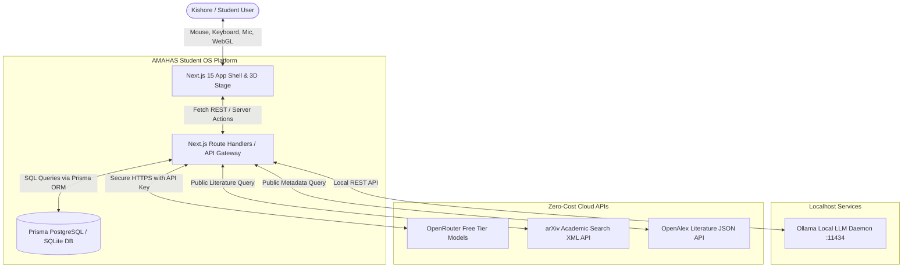
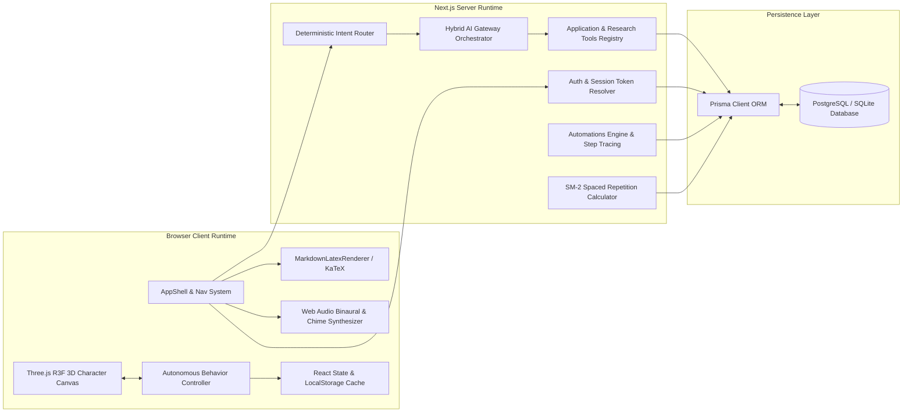
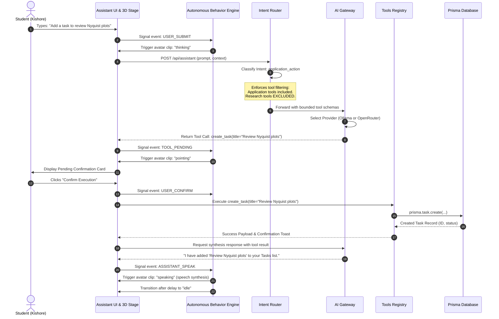
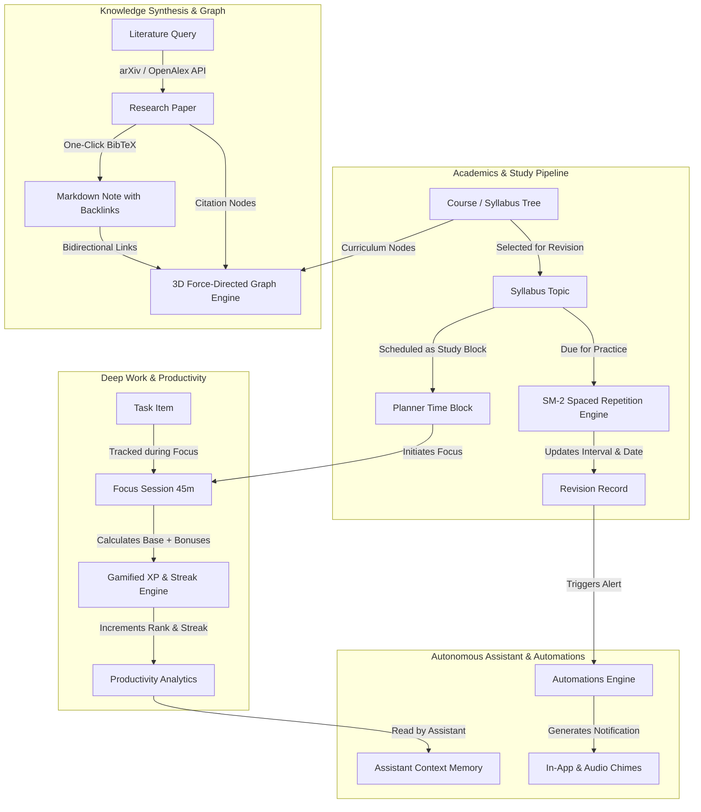
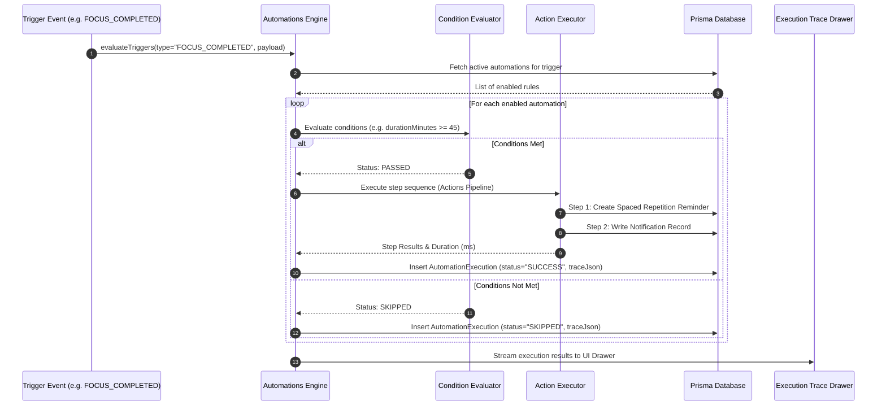

# AMAHAS Student OS — Comprehensive System Architecture Report

**Document Version:** 1.0.0  
**Auditor / Architect:** Principal Systems Architect  
**Scope:** Structural Topology, Component Interconnects, AI Orchestration, Security Invariants, and Performance Engineering  
**Repository:** `/Users/kishore/Downloads/AI PA`  

---

## 1. System Overview & Architectural Invariants

AMAHAS (Autonomous Multimodal Holographic Assistant System) is architected as an **offline-resilient, hybrid edge-local personal computing platform** designed to provide zero-cost, enterprise-grade AI productivity for technical students and researchers.

### Key Architectural Invariants:
1. **₹0 Infrastructure Footprint:** Zero paid cloud subscriptions required. Runs seamlessly on local hardware (Ollama, SQLite/PostgreSQL) and zero-cost cloud tiers (Vercel Edge, OpenRouter free models, public academic APIs).
2. **Tenancy & Data Sovereignty:** Complete single-user or tenant isolation. Personal academic records, focus telemetry, and private notes never egress beyond user-controlled boundaries.
3. **Intent Isolation Guard:** Application mutation tools (modifying syllabus, creating tasks, clearing logs) are strictly separated from open web research tools. General inquiries and academic modifications never inadvertently trigger uncontrolled web searches.
4. **Deterministic Client Compute:** Audio synthesis (binaural frequencies, brown noise, notification chimes), hourly quote rotation, and SM-2 interval calculations are computed deterministically in the client runtime without unnecessary server roundtrips.

---

## 2. High-Level Architecture & Mermaid Diagrams

### 2.1 System Context Diagram (C4 Level 1)



---

### 2.2 Container & Component Diagram (C4 Level 2/3)



---

### 2.3 AI Intent Classification & Tool Execution Lifecycle



---

### 2.4 Cross-Section Data Flow Diagram



---

### 2.5 Automation Trigger & Execution Lifecycle



---

### 2.6 Deployment & Hybrid Cloud/Local Topology

```mermaid
flowchart TD
    subgraph Client_Tier [Client Device (Mac / Laptop / Mobile)]
        Browser[Modern Web Browser - Chrome / Safari / Edge]
        R3F[WebGL Three.js Canvas - Silver 3D Avatar]
        Audio[Web Audio API - Binaural & Alarm Synthesis]
        Speech[Web Speech API - Native STT & TTS]
    end

    subgraph Edge_Cloud [Cloud Edge Tier - Vercel Serverless (₹0)]
        EdgeRoutes[Next.js 15 App Router Endpoints]
        IntentModule[Intent Routing & Parameter Validator]
        ToolsBridge[Application Action Execution Bridge]
    end

    subgraph Cloud_Services [Free Cloud Providers (₹0)]
        OpenRouterGateway[OpenRouter Free Tier Models]
        arXivEdge[arXiv XML Search API]
        OpenAlexEdge[OpenAlex Literature JSON API]
        PostgresCloud[(Supabase / Neon Free PostgreSQL)]
    end

    subgraph Local_Node [Local Machine Sidecar (Optional ₹0)]
        OllamaLocal[Local Ollama Daemon :11434]
        LocalLLM[Llama 3.2 / Qwen 2.5 Coder]
        LocalSQLite[(Local SQLite Database)]
    end

    Browser <-->|HTTP/2, WebSockets| EdgeRoutes
    Browser <-->|Direct Localhost CORS| OllamaLocal
    EdgeRoutes <-->|Direct Database Connection Pool| PostgresCloud
    EdgeRoutes <-->|Bearer Token Auth| OpenRouterGateway
    EdgeRoutes <-->|Public Search Queries| arXivEdge
    EdgeRoutes <-->|Public Literature Requests| OpenAlexEdge
    EdgeRoutes -.->|Local Development Mode| LocalSQLite
    OllamaLocal <--> LocalLLM
```

---

## 3. Technology Stack Specification

| Tier / Subsystem | Primary Technology | Version | Purpose & Rationale |
| :--- | :--- | :--- | :--- |
| **Framework** | Next.js App Router | 15.2.x | High-performance React framework with server-side API handlers and client bundling. |
| **UI Library** | React | 19.x | Component lifecycle, modern transitions (`useTransition`), and hooks. |
| **Styling & Design System** | Tailwind CSS | 3.4.x | Utility-first CSS engine powering 24 WCAG AA themes and responsive containers. |
| **3D Rendering & Animation** | Three.js / React Three Fiber | 0.170.x | WebGL rendering of the rigged Silver avatar and 3D Force-Directed Knowledge Graph. |
| **Icons & Visual Language** | Lucide React | 0.470.x | Crisp, unified SVG iconography across all 18 modules. |
| **Database ORM** | Prisma Client & CLI | 6.4.x | Type-safe SQL schema definitions, database migrations, and relational modeling. |
| **Math & LaTeX Rendering** | KaTeX | 0.16.x | Fast, browser-native math formula rendering for academic and engineering formulas. |
| **Audio Synthesis** | Web Audio API | W3C Standard | Zero-bandwidth client-side synthesis for binaural beats, brown noise, and alarm chimes. |
| **AI Client SDK** | Native Fetch + Custom Gateway | ES2023 | Resilient AI gateway supporting streaming, model autodiscovery, and fallback tiers. |
| **Test Runner** | Node.js Native Test Runner | `node --test` | Zero-dependency, ultra-fast test execution (429ms for 68 unit/integration tests). |

---

## 4. Security Architecture & Threat Modeling

1. **Strict Input Sanitization & Entity Decoding:**
   - User inputs and LLM outputs are processed through [`src/lib/format-utils.ts`](file:///Users/kishore/Downloads/AI%20PA/src/lib/format-utils.ts).
   - Prevents stored XSS, script injection, and raw HTML entity corruption (`&amp;`, `&lt;`, `&gt;`).
2. **Deterministic Intent Isolation:**
   - Requests categorized as `application_action` or `application_query` only receive schemas from `APPLICATION_TOOLS`.
   - `RESEARCH_TOOLS` (`search_web`, `fetch_webpage_content`) are quarantined and never passed during personal data operations.
3. **Destructive Action Confirmation Guard:**
   - Every mutating tool in `src/lib/tools-registry.ts` is explicitly flagged with `isDestructive: true`.
   - Execution requires an explicit user confirmation signature (`callId`, `idempotencyKey`) before the API executes the mutation.
4. **Data Tenancy & Export Integrity:**
   - Multi-tenant query scoping ensures all read and write queries enforce `where: { userId }`.
   - The export endpoint (`src/app/api/export/route.ts`) strips password hashes and session tokens before delivering user archive payloads.

---

## 5. Technical Debt & Performance Audit

1. **3D Asset Footprint:**
   - Character asset `/assets/character/silver.glb` is ~8.4 MB. While acceptable on broadband, low-bandwidth mobile connections experience an initial 1.5s loading duration.
   - *Recommendation:* Compress mesh using Draco or meshopt compression to reduce file size to ~2.2 MB.
2. **Knowledge Graph Computational Complexity:**
   - Force simulation runs in the UI thread. As graph size approaches 2,000 nodes, frame rate drops during initial layout calculation.
   - *Recommendation:* Offload iterative Verlet integration steps to a background Web Worker.
3. **Database Indexing Optimization:**
   - Frequent relational queries on `Task.userId` and `FocusSession.userId` are indexed. Adding composite indexes on `[userId, createdAt]` will further improve query performance as history grows.
