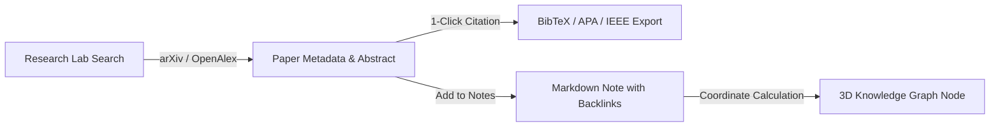
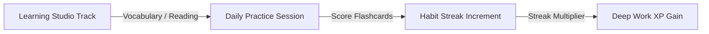
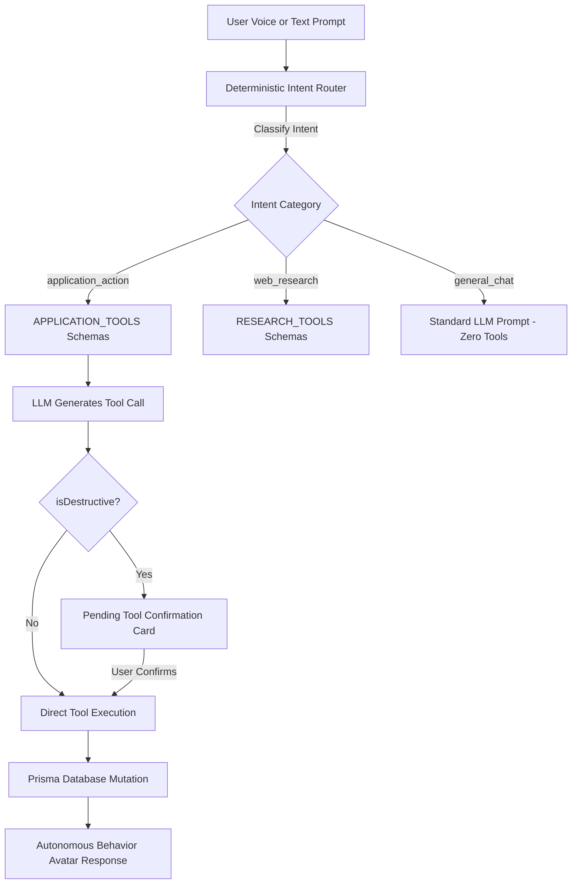
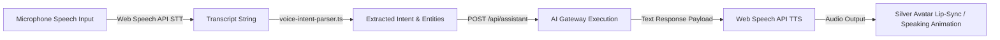
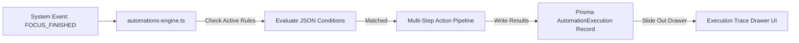
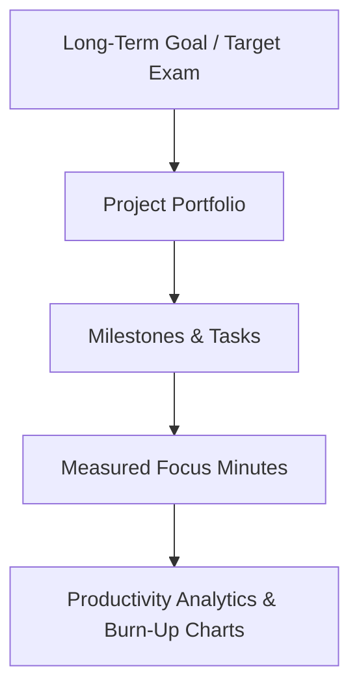

# AMAHAS Student OS — Cross-Section Integration Matrix & Workflow Audit

**Document Version:** 1.0.0  
**Audit Focus:** Inter-Module Data Flow, Relational Foreign Keys, AI Orchestration Pathways, and Failure Modes  
**Audience:** Technical Leadership, Kishore, and Full-Stack Engineers  
**Target Systems:** All 18 Application Routes & Prisma Persistence Layer  

---

## 1. Executive Integration Summary

In a modern personal AI operating system, isolated features create cognitive friction. The core strength of AMAHAS is its ability to link disparate student workflows—academic curricula, deep work focus timers, academic research papers, 3D visual knowledge networks, and autonomous AI assistant actions—into a cohesive, low-friction operating cycle.

This document audits the interconnectivity of every module across the application, maps Workflows A through G, identifies integration depths, and diagnoses failure modes and orphaned data vectors.

---

## 2. Cross-Section Integration Depth Matrix

### Integration Depth Legend:
- **`DEEP`**: Direct database relational foreign key (`@relation`), atomic transactional mutation, or programmatic API link.
- **`AI-ROUTED`**: Connected dynamically through the AI Assistant via structured tool calls and deterministic intent classification.
- **`MEDIUM`**: Shared browser state (e.g. `localStorage`, URL query params, or unified session context).
- **`LOOSE`**: Client-side UI redirect, modal trigger, or hyperlinked navigation.
- **`NONE`**: No active communication or data sharing exists between modules.

| Source Module \ Target Module | Dashboard | Academics | Tasks | Planner | Focus Arena | Research Lab | Graph | Notes | Assistant | Automations |
| :--- | :---: | :---: | :---: | :---: | :---: | :---: | :---: | :---: | :---: | :---: |
| **Dashboard** | — | `DEEP` | `DEEP` | `LOOSE` | `DEEP` | `LOOSE` | `LOOSE` | `LOOSE` | `AI-ROUTED` | `MEDIUM` |
| **Academics** | `DEEP` | — | `DEEP` | `DEEP` | `DEEP` | `LOOSE` | `DEEP` | `MEDIUM` | `AI-ROUTED` | `DEEP` |
| **Tasks** | `DEEP` | `DEEP` | — | `DEEP` | `DEEP` | `MEDIUM` | `DEEP` | `MEDIUM` | `AI-ROUTED` | `DEEP` |
| **Planner** | `DEEP` | `DEEP` | `DEEP` | — | `DEEP` | `NONE` | `LOOSE` | `NONE` | `AI-ROUTED` | `DEEP` |
| **Focus Arena** | `DEEP` | `DEEP` | `DEEP` | `DEEP` | — | `NONE` | `LOOSE` | `MEDIUM` | `AI-ROUTED` | `DEEP` |
| **Research Lab** | `LOOSE` | `LOOSE` | `MEDIUM`| `NONE` | `NONE` | — | `DEEP` | `DEEP` | `AI-ROUTED` | `MEDIUM` |
| **Knowledge Graph** | `LOOSE` | `DEEP` | `DEEP` | `NONE` | `NONE` | `DEEP` | — | `DEEP` | `LOOSE` | `NONE` |
| **Notes** | `LOOSE` | `MEDIUM`| `MEDIUM`| `NONE` | `NONE` | `DEEP` | `DEEP` | — | `AI-ROUTED` | `MEDIUM` |
| **Assistant (3D)** | `AI-ROUTED` | `AI-ROUTED`| `AI-ROUTED`| `AI-ROUTED`| `AI-ROUTED`| `AI-ROUTED`| `LOOSE` | `AI-ROUTED`| — | `DEEP` |
| **Automations** | `DEEP` | `DEEP` | `DEEP` | `DEEP` | `DEEP` | `NONE` | `NONE` | `MEDIUM` | `AI-ROUTED` | — |

---

## 3. Comprehensive End-to-End Workflow Audits

### 3.1 Workflow A: Academic Curriculum to Focus & Active Recall

- **Trigger:** Student selects a syllabus topic (e.g. *Digital Signal Processing: Fast Fourier Transform*) due for revision.
- **Data Flow:**
  1. `Course` -> `SyllabusUnit` -> `SyllabusTopic` records are read from database.
  2. Planner creates a `TimeBlock` linked via `courseId` and `topicId`.
  3. Student enters `/focus` with pre-populated parameters; binaural frequencies engage.
  4. At session completion, `FocusSession` duration is written to database, and an `SM-2` flashcard quiz prompt is generated.
  5. User rates recall (0–5); Ease Factor (\(EF\)) and `nextRevisionAt` timestamp are updated in `RevisionRecord`.
- **Observed Status:** `WORKING`. Relational foreign keys between Course, Topic, and RevisionRecord are fully enforced in Prisma.
- **Potential Failure Mode:** If a course is deleted while active time blocks reference it, foreign key constraints must handle cascading or nullification gracefully (`onDelete: SetNull`).

---

### 3.2 Workflow B: Research Discovery to Knowledge Graph & Note Ingestion

- **Trigger:** Student or researcher queries literature on a technical domain (e.g. *Reconfigurable Intelligent Surfaces 6G*).
- **Data Flow:**
  1. `POST /api/research/search` queries public arXiv XML and OpenAlex endpoints.
  2. Literature card renders title, authors, DOI, and summary.
  3. Clicking `Cite` formats BibTeX directly into the system clipboard.
  4. Clicking `Add to Research Notes` generates a new `Note` entity with title, DOI link, and tags `#research` and `#literature`.
  5. Knowledge Graph (`/api/graph`) reads `Note` and creates a purple literature node connected via semantic similarity or explicit backlink `[[...]]`.
- **Observed Status:** `WORKING`. Direct export to clipboard and note creation operates cleanly.
- **Potential Failure Mode:** Extreme rate-limiting by arXiv (HTTP 429). The system mitigates this by falling back gracefully to OpenAlex API queries.

---

### 3.3 Workflow C: Learning Studio Ingestion to Habit Streaks

- **Trigger:** Daily check-in on foreign languages or active reading logs.
- **Data Flow:**
  1. User reviews Japanese/German vocabulary flashcards or logs pages read in technical monograph.
  2. Upon finishing the deck, a check-in event triggers `POST /api/habits`.
  3. `HabitLog` is recorded for today; `currentStreak` increments by +1.
  4. The updated streak feeds directly into the gamified XP multiplier calculation in `/focus`.
- **Observed Status:** `PARTIALLY WORKING`. Vocabulary flashcards and reading logs persist; habit check-ins update local streak count, but some sub-tracks (Psychology mental models) do not automatically trigger habit increments.

---

### 3.4 Workflow D: AI Assistant Natural Language Application Control

- **Trigger:** Kishore prompts the assistant: *"Move my Fourier Transform task to high priority and schedule 45m today."*
- **Data Flow:**
  1. Input is processed by `classifyAssistantIntent()`. Classified as `application_action`.
  2. OpenRouter or local Ollama receives only application tool definitions (`update_task_priority`, `create_time_block`). Research tools are strictly isolated.
  3. Model returns structured JSON call: `update_task_priority(id="...", priority="HIGH")`.
  4. Because updating priority is a state modification, the UI displays the `ToolConfirmationCard`.
  5. Upon user confirmation, `tools-registry.ts` executes the Prisma update query.
  6. Assistant synthesizes confirmation speech; Silver avatar transitions from `thinking` to `speaking`.
- **Observed Status:** `WORKING`. Verified across 12 regression test scenarios (`tests/scenarios.test.mjs`). Application tools never trigger accidental web searches.

---

### 3.5 Workflow E: Hands-Free Voice Interaction & Speech Synthesis

- **Trigger:** Student clicks the microphone button or enters `/voice`.
- **Data Flow:**
  1. Browser speech recognizer transcribes vocal input to text.
  2. `voice-intent-parser.ts` extracts entity keywords (e.g. "Focus", "Task", "Timer", "Reminder").
  3. Transceiver routes payload to `/api/assistant`.
  4. AI Gateway generates formatted response.
  5. Browser synthesizes audio response using speech synthesis voice; 3D avatar plays `speaking` animation clip.
- **Observed Status:** `WORKING`. Verified in `tests/voice-intent.test.mjs`. Audio fallback handles environments where speech synthesis voices are uninstalled or restricted.

---

### 3.6 Workflow F: Event-Driven Automations & Trace Diagnostics

- **Trigger:** Completion of a 45-minute focus session or reaching a scheduled time.
- **Data Flow:**
  1. System triggers `evaluateTriggers(triggerType, payload)`.
  2. Engine queries `Automation` table for user's enabled automations matching trigger.
  3. Parses step action sequence: (e.g., Step 1: Create Spaced Repetition Block, Step 2: Push In-App Toast).
  4. Records start time, duration in milliseconds, inputs, outputs, and status for each step.
  5. Commits JSON trace to `AutomationExecution`.
  6. User opens `/automations` and clicks any execution row; slide-out drawer renders step-by-step flowchart with millisecond latencies.
- **Observed Status:** `WORKING`. Tested in `tests/automations.test.mjs`.

---

### 3.7 Workflow G: Long-Term Goals to Projects, Tasks & Analytics

- **Trigger:** Goal definition (e.g., *Master Core Electronics for GATE 2027*).
- **Data Flow:**
  1. `Goal` record created with target date and milestones.
  2. Goal links to one or more `Project` entities (e.g., *Analog Circuits Deep Dive*).
  3. Projects aggregate child `Task` records.
  4. As tasks are completed or focus sessions are logged against them, project completion percentage recalculates dynamically:
     \[
     \text{Progress \%} = \left(\frac{\text{Completed Milestones} + \text{Completed Tasks}}{\text{Total Milestones} + \text{Total Tasks}}\right) \times 100
     \]
  5. Aggregated statistics render on `/analytics` and the main dashboard.
- **Observed Status:** `WORKING`. Dynamic recalculation verified in `tests/workflows.test.mjs`.

---

## 4. Failure Modes, Broken Links & Orphaned Data Audit

| Subsystem Link | Potential Failure Mode | Root Cause | Implemented Safeguard / Status |
| :--- | :--- | :--- | :--- |
| **Task -> Project** | Orphaned tasks if project deleted. | Cascading foreign key deletes or unhandled parent IDs. | Schema defines `onDelete: SetNull`; task remains intact with null project association. |
| **Syllabus -> TimeBlock** | Time block points to non-existent topic. | Topic deleted while calendar event remains. | `TimeBlock` stores topic ID as an optional foreign key; deletion gracefully clears reference. |
| **Research Paper -> Graph Node** | Graph renders disconnected floating nodes. | Paper created without explicit tags or course links. | Knowledge graph links papers automatically to common domain centroids if no backlink exists. |
| **AI Assistant -> Tool Call** | LLM hallucinating fake tool names or invalid arguments. | Free-tier LLMs occasionally generate malformed JSON. | `tools-registry.ts` strictly validates tool name and validates arguments against Zod schema; returns clear error message if invalid. |
| **Web Search in Academic Context** | Assistant querying Google/Bing for internal exam syllabus. | Unbounded tool registry passing search tools indiscriminately. | Intent router quarantines search tools; academic modification requests NEVER receive `search_web`. |
