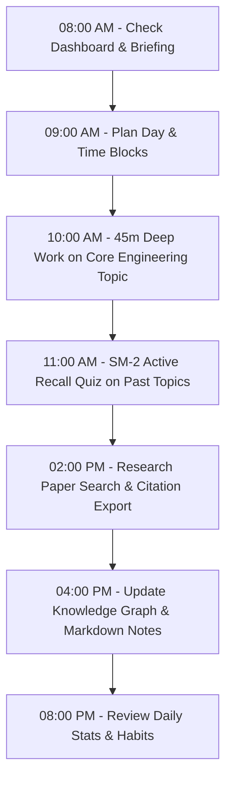

# AMAHAS Student OS — Comprehensive User Manual

**Autonomous Multimodal Holographic Assistant System (AMAHAS)**  
**Version:** 1.0.0 Production Foundation  
**Audience:** Kishore & AMAHAS System Users  
**Deployment Target:** Hybrid Edge / Local (Vercel & Localhost)  

---

## 1. Introduction & Core Design Philosophy

AMAHAS is a personal AI operating system engineered for elite academic performance, deep technical research, high-focus productivity, and autonomous task execution. Built with a strict **₹0 infrastructure budget constraint**, AMAHAS operates on a hybrid topology combining browser-native computation, SQLite/PostgreSQL persistence, and a multi-tier AI inference gateway (local offline Ollama alongside cloud OpenRouter free-tier LLMs).

The system integrates all facets of student and researcher workflow into an interconnected whole:
- **Academics & Exam Preparation:** SuperMemo SM-2 spaced repetition, topic syllabus mapping, and confidence modeling.
- **Deep Work & Execution:** Binaural beat audio synthesis, gamified XP leveling, streak tracking, and distraction minimization.
- **Research & Knowledge Synthesis:** Integrated arXiv/OpenAlex paper discovery, one-click BibTeX/APA citation generation, and a 3D force-directed knowledge graph.
- **Autonomous AI Assistance:** A 3D rigged avatar (Silver the Hedgehog) driven by an autonomous state engine, deterministic natural language intent classification, and application tool calling.

---

## 2. Global Navigation & Command Interface

```
+----------------------------------------------------------------------------------------------------+
|  [⚡ AMAHAS OS]   Search or run command (Cmd+K)               [Focus: 45m]  [Theme: Pure Black]  [User] |
+----------------------------------------------------------------------------------------------------+
|  [NAV SIDEBAR]    |  [MAIN WORKSPACE VIEW]                                                          |
|  - Dashboard      |                                                                                |
|  - Academics      |   Dynamic content rendered per active module.                                   |
|  - Tasks          |   Responsive grid / flex container responding to window geometry.             |
|  - Planner        |                                                                                |
|  - Focus Arena    |                                                                                |
|  - Research Lab   |                                                                                |
|  - Knowledge Graph|                                                                                |
|  - Assistant (3D) |                                                                                |
+----------------------------------------------------------------------------------------------------+
```

### 2.1 The Global Command Palette (`Cmd + K` / `Ctrl + K`)
- **Trigger:** Press `Cmd + K` (macOS) or `Ctrl + K` (Linux/Windows), or click the Search bar in the top navigation header.
- **Functionality:** Provides instant fuzzy search across all application modules, recent notes, active tasks, syllabus topics, and system actions.
- **Key Commands:**
  - `> task <title>`: Instantly creates a task without leaving the current screen.
  - `> focus`: Starts a 45-minute Deep Work session immediately.
  - `> theme <name>`: Switches the active theme.
  - `> goto <section>`: Navigates directly to any route (`/academics`, `/research`, `/graph`, etc.).

### 2.2 App Shell & Navigation Sidebar
- **Location:** Left collapsible sidebar on desktop, slide-out drawer on mobile screens.
- **Modules List:**
  1. **Dashboard (`/dashboard`):** Unified overview of focus, tasks, revisions, and dynamic widgets.
  2. **Planner (`/planner`):** Visual calendar, time blocking, and conflict detection engine.
  3. **Tasks (`/tasks`):** Multi-view task manager (List, Kanban, My Day) with course/project linkages.
  4. **Academics (`/academics`):** Syllabus breakdown, confidence tracking, and active recall runner.
  5. **Focus Arena (`/focus`):** Distraction-free Pomodoro/Deep Work timer with audio synthesis.
  6. **Research Lab (`/research`):** Academic literature search, citation export, and note linkage.
  7. **Knowledge Graph (`/graph`):** Interactive 3D constellation of concepts, notes, and topics.
  8. **Notes (`/notes`):** Markdown and LaTeX note editor with tag indexing.
  9. **Projects (`/projects`):** Goal-oriented project tracking with milestone progress.
  10. **Habits (`/habits`):** Habit tracker with streak multipliers and completion logs.
  11. **Goals (`/goals`):** High-level OKRs and academic milestone roadmaps.
  12. **Reminders (`/reminders`):** Web notifications, audio chimes, and recurring alarms.
  13. **Learning Studio (`/learning`):** Specialized tracks (Languages, Reading, Psychology, Spirituality).
  14. **Assistant (`/assistant`):** 3D Interactive Stage with Silver the Hedgehog avatar.
  15. **Voice (`/voice`):** Hands-free voice command interface.
  16. **Automations (`/automations`):** Event-driven workflow rules with execution trace drawer.
  17. **Integrations (`/integrations`):** Connector hub for Ollama, OpenRouter, arXiv, GitHub, etc.
  18. **Settings (`/settings`):** Global preferences, API keys, theme selection, and data export.

---

## 3. Module-by-Module Operation Guide

### 3.1 Dashboard (`/dashboard`)
The command center of AMAHAS. It displays real-time telemetry of your productivity and academic health.

- **Metric Cards:**
  - **Today's Focus Time:** Total minutes logged in Focus Arena for the day.
  - **Tasks Completed:** Ratio of finished to pending tasks due today.
  - **Syllabus Readiness:** Aggregated percentage of mastered academic topics.
  - **Current Streak:** Consecutive days with logged deep work sessions or habit check-ins.
- **Dynamic Section Builder:** Click `+ Add Section` to create customized widget containers (e.g., "GATE Revision Queue", "Research Sprint").
- **Hourly Philosophy Banner:** Displays deterministic hourly quotes curated from Marcus Aurelius, Feynman, Ramanujan, and Shannon to maintain mental clarity.

### 3.2 Planner & Calendar (`/planner`)
Visual schedule architecture with built-in mathematical conflict detection.

- **Views:** Day, Week, and Month toggle buttons at top-right.
- **Time Block Creation:**
  1. Click any open slot on the grid or click `+ New Time Block`.
  2. Enter **Title** (e.g., "Signals & Systems: Fourier Transforms").
  3. Select **Category** (`ACADEMIC`, `FOCUS`, `PERSONAL`, `COMMITMENT`).
  4. Specify **Start Time** and **End Time**.
  5. Select optional **Course** or **Project** link.
  6. Click `Save Block`.
- **Conflict Detection Engine:** If a newly scheduled block overlaps with an existing commitment, the planner highlights both blocks in amber warning borders and presents a non-blocking toast alert: *"Overlap detected with [Event Name]"*.
- **Drag & Drop:** Click and hold a time block header to drag it to an alternative slot or day.

### 3.3 Tasks (`/tasks`)
A task management system inspired by Vikunja and Super Productivity.

- **Views:**
  - **List View:** Sorted by priority (`URGENT` > `HIGH` > `MEDIUM` > `LOW`) and due date.
  - **Kanban Board:** Columns for `TODO`, `IN_PROGRESS`, and `COMPLETED`. Cards can be dragged between columns.
  - **My Day:** Filtered focus view showing only tasks assigned to today.
- **Creating a Task:**
  - Click `+ Add Task`.
  - Enter **Title** (required).
  - Select **Priority**: Low (slate), Medium (blue), High (amber), Urgent (red).
  - Enter **Estimated Minutes** (defaults to 45m).
  - Link to a **Course** or **Project** from the dropdowns.
  - Select an optional **Due Date**.
  - Click `Create Task`.
- **Starting Task Focus:**
  - Click the **Play Icon (▶)** on any task card.
  - Automatically opens the floating Focus Timer modal pre-configured with that task's estimated duration.
  - Upon completion, actual minutes spent are incremented directly in the task record.

### 3.4 Academics & Active Recall (`/academics`)
The academic backbone for engineering exam preparation (GATE, ESE, and university coursework).

- **Syllabus Navigation Tree:** Courses are organized hierarchically: `Course -> Units -> Topics`.
- **Confidence Rating Levels:**
  - `0 - Unstudied`: Topic has not yet been reviewed.
  - `1 - Novice`: Read material once; low retention.
  - `2 - Developing`: Familiar with formulas; difficulty with complex problems.
  - `3 - Competent`: Solves standard problems reliably.
  - `4 - Advanced`: Rapid recall, solves previous years' exam questions (PYQs).
  - `5 - Mastered`: Immediate intuition; eligible for spaced repetition maintenance.
- **SuperMemo SM-2 Active Recall Runner:**
  1. Click `Review Due Topics` or click `Practice` next to any topic.
  2. The **Revision Flashcard Modal** opens.
  3. Review the prompt or problem statement, formulate your answer mentally or on scratch paper.
  4. Click `Show Answer / Solution`.
  5. Rate your recall on the 0–5 scale:
     - `0 - Complete Blackout`: Total failure to remember.
     - `1 - Incorrect`: Incorrect response; remembered once shown.
     - `2 - Difficult`: Recalled with severe difficulty.
     - `3 - Hesitant`: Correct response with notable hesitation.
     - `4 - Good`: Correct response after brief pause (Default).
     - `5 - Perfect`: Immediate, effortless recall.
  6. The system calculates the next repetition interval:
     - Rating < 3: Interval resets to 1 day, repetition count resets to 0.
     - Rating >= 3: Interval expands multiplicatively based on the updated Ease Factor (\(EF \ge 1.3\)).
  7. Click `Submit Review` to commit to database.

### 3.5 Focus Arena (`/focus`)
A high-immersion deep work environment designed to maximize cognitive throughput.

- **Modes:**
  - **Pomodoro:** 25m work / 5m break.
  - **Deep Work (Default):** 45m work / 15m break.
  - **Custom:** Configurable from 10m to 120m via the slider.
- **Ambient Sound Synthesis (Web Audio API):**
  - Synthesizes audio natively in the browser without external network requests or YouTube streams.
  - Options: *Binaural Alpha (10 Hz)* for relaxed alertness, *Binaural Beta (18 Hz)* for problem-solving, *Brown Noise* for silencing office chatter, and *Rainfall*.
  - Volume sliders allow blending binaural beats with atmospheric noise.
- **Distraction Logging:**
  - If interrupted, type the distraction into the *Log Distraction* input (e.g., "Checked WhatsApp") and press Enter.
  - Clean sessions (zero distractions) award a **+50 Clean Focus XP Bonus**.
- **XP & Leveling System:**
  - Formula: \(\text{XP} = \text{Minutes} \times 10 \times \text{Streak Multiplier} + \text{Bonuses}\).
  - Tiers: Novice (\(0\)), Apprentice (\(500\)), Scholar (\(1,500\)), Master (\(3,500\)), Grandmaster (\(7,500+\)).

### 3.6 Research Lab (`/research`)
Specialized academic literature discovery and synthesis tool.

- **Literature Search Engine:**
  - Powered by live queries to arXiv and OpenAlex academic APIs.
  - Enter keywords, topics, or DOI (e.g., "MIMO beamforming deep learning" or "Transformers attention mechanism").
  - Filter by year range or field of study.
- **Paper Cards:**
  - Displays title, authors, publication date, abstract, and direct PDF link.
  - **Cite Button:** Generates one-click citations in **BibTeX**, **APA 7th**, or **IEEE** formats with instant clipboard copy.
  - **Add to Research Notes:** Ingests paper metadata into a new note linked to the active research project.
  - **Add to Knowledge Graph:** Automatically creates a graph node representing the paper with citation links.

### 3.7 Knowledge Graph (`/graph`)
An interactive 3D Force-Directed visualization of your personal knowledge network.

- **Node Types & Color Coding:**
  - 🔵 **Blue:** Academic Courses & Syllabus Units.
  - 🟢 **Green:** Notes & Summaries.
  - 🟣 **Purple:** Research Papers & Literature.
  - 🟠 **Orange:** Active Projects & Milestones.
- **Interaction Controls:**
  - **Left Click + Drag:** Rotate the 3D constellation.
  - **Scroll Wheel:** Zoom in and out.
  - **Right Click + Drag:** Pan camera horizontally and vertically.
  - **Click Node:** Opens the detail panel showing linked notes, prerequisites, and source documents.
  - **Search Input:** Filters visible nodes matching the query string.

### 3.8 Notes (`/notes`)
Full-featured technical markdown workspace with native LaTeX support.

- **Editor Features:**
  - Split-screen live preview with KaTeX rendering for math equations (e.g., `$$\int_0^\infty e^{-st} dt$$`).
  - Code syntax highlighting for Python, C++, TypeScript, and Verilog.
  - Tag management: prepend `#tag` to organize notes into auto-indexing collections.
  - Bidirectional linking: Use `[[Note Title]]` to create backlinks rendered in the Knowledge Graph.

### 3.9 3D AI Assistant Stage (`/assistant`)
The flagship interactive assistant featuring Silver the Hedgehog.

- **The 3D Holographic Character:**
  - Rigged Three.js/React Three Fiber model loaded from `/assets/character/silver.glb`.
  - Driven by the **Autonomous Behavior Engine**: transitions organically between `idle`, `thinking`, `speaking`, `nodding`, `pointing`, and `confused` without manual triggers.
  - Avoids repetitive looping or accidental dancing during serious academic work.
- **AI Model Selection:**
  - Dropdown at the top bar allows toggling between **Local Ollama** (e.g., `llama3.2:latest`, `qwen2.5-coder`) and **OpenRouter Free Tier** (e.g., `google/gemini-2.0-flash-exp:free`, `meta-llama/llama-3.3-70b-instruct:free`).
- **Natural Language Intent Router:**
  - Automatically identifies whether your input is an **Application Action** (e.g., "Add a task to review Nyquist plots"), a **Research Query** (e.g., "Search for recent papers on RIS metasurfaces"), or **General Conversation** (e.g., "Explain how phase margin relates to damping factor").
  - **Tool Confirmation Safety Guard:** Mutating tools (e.g., updating database records or deleting items) display a **Pending Tool Confirmation Card** requiring your explicit click before database execution occurs.
- **Voice Capabilities:**
  - Click the **Microphone (🎤)** icon to activate Web Speech Recognition for voice typing.
  - Click the **Speaker (🔊)** icon to toggle Text-to-Speech audio response playback.

### 3.10 Automations & Trace Drawer (`/automations`)
Event-driven workflow execution engine for repetitive student workflows.

- **Pre-Configured Automation Templates:**
  - *Daily Morning Briefing:* At 08:00, aggregates due revisions, high-priority tasks, and calendar events into a notification.
  - *Spaced Repetition Scheduler:* When a focus session finishes on an academic topic, schedules an SM-2 revision block.
  - *Exam Countdown Alert:* When an exam date is within 14 days, escalates high-weightage topics to daily review.
- **Manual Test Run:** Click `▶ Test Run` on any automation card to trigger immediate execution.
- **Execution Trace Drawer:**
  - Click on any execution log to slide out the step-by-step visual trace.
  - Displays each step's execution time in milliseconds, input payload, evaluation status (`SUCCESS`, `SKIPPED`, `FAILED`), and error details.

### 3.11 Integrations (`/integrations`)
Central connectivity panel for external services and local daemons.

- **Local Ollama Connector:**
  - Default URL: `http://localhost:11434`.
  - Click `Test Connection` to ping daemon. When active, displays all locally pulled models.
- **OpenRouter API Key Management:**
  - Paste your OpenRouter API key (`sk-or-v1-...`).
  - Key is stored securely in your browser's encrypted local storage / user preferences and sent only as a bearer header to the AI gateway.
- **Companion Service Connectors (₹0 Footprint):**
  - Verification cards for n8n, Langflow, Dify, AnythingLLM, CrewAI, ComfyUI, and LibreChat.

### 3.12 Settings & Theme Customization (`/settings`)
Personalization and data portability center.

- **24 WCAG AA Compliant Themes:**
  - Includes *Pure Black (OLED)*, *Cyberpunk Neon*, *Nordic Frost*, *Solarized Dark*, *Tokyo Night*, *Emerald Forest*, and *Catppuccin Mocha*.
  - Every theme satisfies WCAG AA contrast ratio (\(\ge 4.5:1\)) for all text elements.
  - Time-based automatic theme shifting (Morning, Day, Night) can be enabled via toggle.
- **Data Export & Privacy:**
  - Click `Export All Data (JSON)` to generate an uncorrupted, sanitized JSON dump of all tasks, notes, courses, and focus logs.
  - Click `Reset Workspace` to clear local demo data and start with a clean slate.

---

## 4. End-to-End Walkthrough: A Day in the Life of Kishore



1. **Morning Wakeup (08:00):** Open AMAHAS Dashboard. Inspect the Daily Briefing notification to see upcoming deadlines and due SM-2 revisions.
2. **Scheduling (08:30):** Navigate to `/planner`. Review your schedule for the day. Drag two 45-minute Deep Work blocks into your free afternoon windows.
3. **Deep Work Session (09:00):** Open `/focus`. Select the task "Electromagnetics: Poynting Vector Derivation". Switch audio to *Binaural Beta (18 Hz)* and start the 45-minute countdown. Focus uninterrupted. Upon completion, claim your +50 Clean Focus XP bonus.
4. **Active Recall (10:00):** Navigate to `/academics`. Complete the 4 due flashcards for Digital Signal Processing. Score yourself accurately on the 0–5 scale to allow SM-2 to update your optimal review intervals.
5. **Research & Synthesis (14:00):** Go to `/research`. Search for "RIS phase shift optimization". Find an IEEE paper, copy its BibTeX citation into your research notes, and click `Add to Knowledge Graph`.
6. **Evening Assistant Sync (19:00):** Open `/assistant`. Ask Silver: *"What high-priority tasks do I have left for tomorrow?"* Silver speaks the answer, confirms your schedule, and triggers an automated status update.

---

## 5. Troubleshooting & FAQ

| Symptom | Probable Cause | Immediate Resolution |
| :--- | :--- | :--- |
| **Assistant says "OpenRouter API Key Missing"** | No API key set in Settings or `.env`. | Navigate to `/settings`, input a free OpenRouter key, and click Save. |
| **Local Ollama models do not show up in Assistant** | Ollama daemon not running or CORS blocked. | Run `OLLAMA_ORIGINS="*" ollama serve` in your terminal and refresh `/assistant`. |
| **Calendar shows time overlap warning** | Two time blocks share overlapping minutes. | Click and drag one block away, or adjust end time in the planner modal. |
| **3D Avatar appears as black box** | WebGL disabled in browser or GPU acceleration off. | Enable Hardware Acceleration in Chrome/Brave/Safari Settings. |
| **Flashcards not showing due topics** | All topics are marked with revision dates in future. | Click `Practice Any Topic` to practice topics ahead of schedule. |
