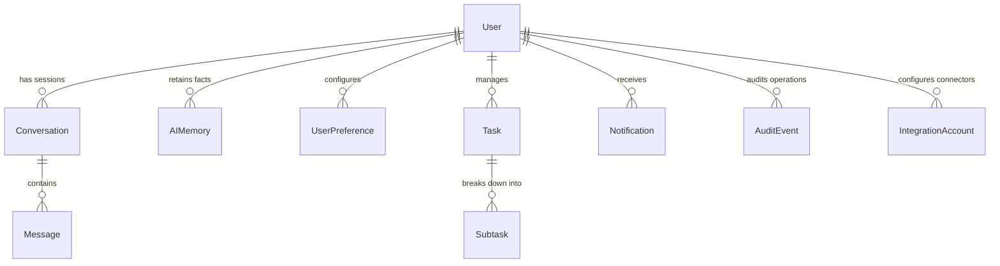

# AMAHAS — Unified Persistence Architecture & Memory Model

This document outlines the persistence model for the AMAHAS Personal Operating System. All core data is unified under Prisma ORM with durable PostgreSQL backing (via Supabase) and local SQLite support.

---

## 1. Entity Architecture

---

## 2. Model Specifications

### 2.1 Conversations & Messages
- **`Conversation`**:
  - `id`: Unique session identifier (CUID).
  - `userId`: Foreign key to `User` ensuring cross-tenant scoping.
  - `title`: Dynamic session title based on the opening prompt.
  - `modelUsed`: Records the exact LLM identifier (e.g. `openrouter/free`, `ollama/llama3.2`).
  - `updatedAt`: Session recency for chronological conversation history retrieval.
- **`Message`**:
  - `id`: CUID.
  - `role`: `"user" | "assistant" | "system" | "tool"`.
  - `content`: Markdown text content with code fences and synthesized summaries.
  - `toolCallsJson`: Structured JSON array of tool invocations generated by the model.
  - `toolResultsJson`: Verified responses from executed tool handlers.

### 2.2 AI Memory & Personal Context
- **`AIMemory`**:
  - `key`: Specific attribute identifier (e.g., `PRIMARY_FOCUS`, `PREFERRED_REVISION_TIME`, `PROJECT_DEADLINE`).
  - `value`: Verified context string.
  - `category`: `"preference" | "academic" | "research" | "goal" | "general"`.
  - `isApproved`: Boolean gate ensuring memories are user-verified before injection into future prompt contexts.
  - `source`: Attribution string (`"User confirmed" | "Inferred"`).
  - **Constraint**: `@@unique([userId, key])` prevents conflicting duplicate memory entries.

### 2.3 User Preferences & System Configuration
- **`UserPreference`**:
  - `aiModelPreference`: Default selected model (`"openrouter/free"`).
  - `aiCreativity`: Temperature float (default `0.7`).
  - `enableVoiceInput`: Boolean microphone permission flag.
  - `enableVoiceOutput`: Boolean text-to-speech speaker toggle.
  - `preferredFocusMinutes`: Standard Deep Work session length (default 45 min).
  - `theme`: Selected aesthetic token (`"pure-black"`, `"cyberpunk-neon"`, etc.).

### 2.4 Tasks & Notifications
- **`Task`**:
  - `status`: `"TODO" | "IN_PROGRESS" | "COMPLETED" | "CANCELLED"`.
  - `priority`: `"LOW" | "MEDIUM" | "HIGH" | "URGENT"`.
  - `dueDate` & `scheduledDate`: Time block boundaries for calendar conflict detection.
  - `estimatedMinutes` & `actualMinutes`: Productivity metrics for review summaries.
- **`Notification`**:
  - Category: `"DEADLINE" | "REVISION" | "REVIEW" | "INTEGRATION" | "AUTOMATION"`.
  - Scoped to user with unread state indexing (`@@index([userId, isRead])`).

### 2.5 Security, Tools & Audit Trails
- **`AuditEvent`**:
  - `action`: Audit identifier (e.g. `"TOOL_MUTATION:<idempotencyKey>"`, `"AUTH_LOGIN"`, `"DATA_EXPORT"`).
  - `detailsJson`: Serialized execution payload and result for idempotent replay prevention.
  - `ipAddress` & `userAgent`: Security provenance metadata.
  - `createdAt`: Immutable timestamp for compliance and auditing.

### 2.6 Connectors & Integration Accounts
- **`IntegrationAccount`**:
  - `provider`: `"OPENROUTER" | "OLLAMA" | "OPENALEX" | "ARXIV" | "WIKIPEDIA" | "GITHUB" | "VIKUNJA" | "N8N"`.
  - `status`: `"NOT_CONFIGURED" | "CONNECTED" | "ERROR" | "DISCONNECTED"`.
  - `endpointUrl`: Configurable daemon address (e.g., `http://localhost:11434` for Ollama).
  - `lastSyncAt`: Timestamp of the latest successful health check or sync event.
  - `lastError`: Error description if connectivity failed.

---

## 3. Strict Security Rules

1. **Zero Secrets in Memory**:
   - API tokens (`OPENROUTER_API_KEY`, passwords, session secrets) are **never** stored in `AIMemory`, `Message.content`, or exposed in client responses.
2. **Single Unified Store**:
   - Competing vector databases or parallel storage solutions are not introduced during Phase 1 to prevent data fragmentation and keep memory footprint low.
3. **Cross-Tenant Isolation**:
   - Every database query in API routes strictly asserts `where: { userId }` using the server-resolved session user ID.
